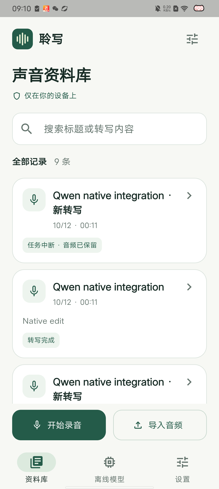
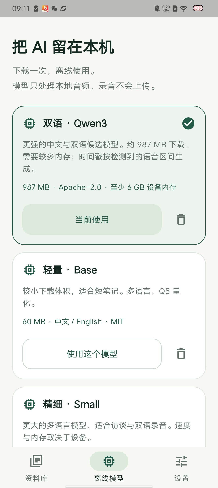
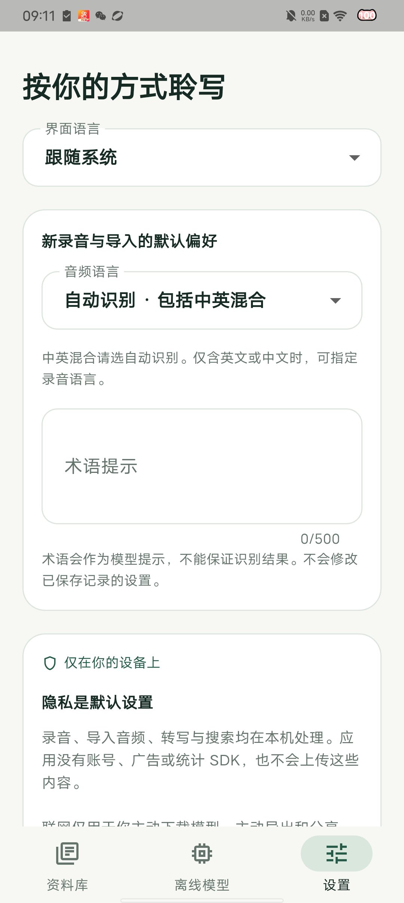
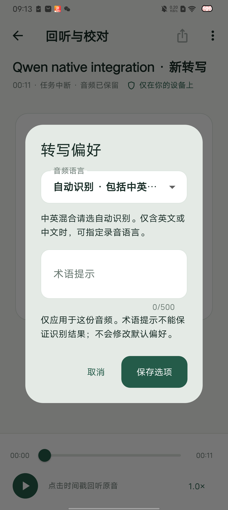
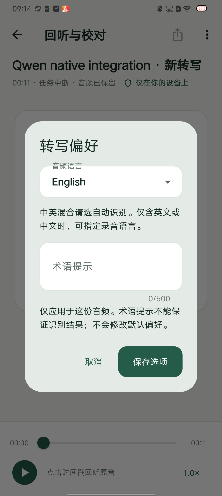
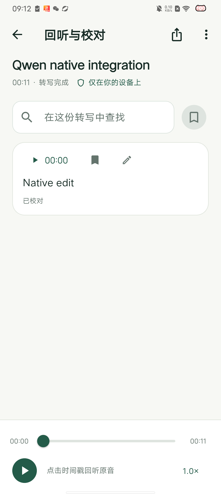
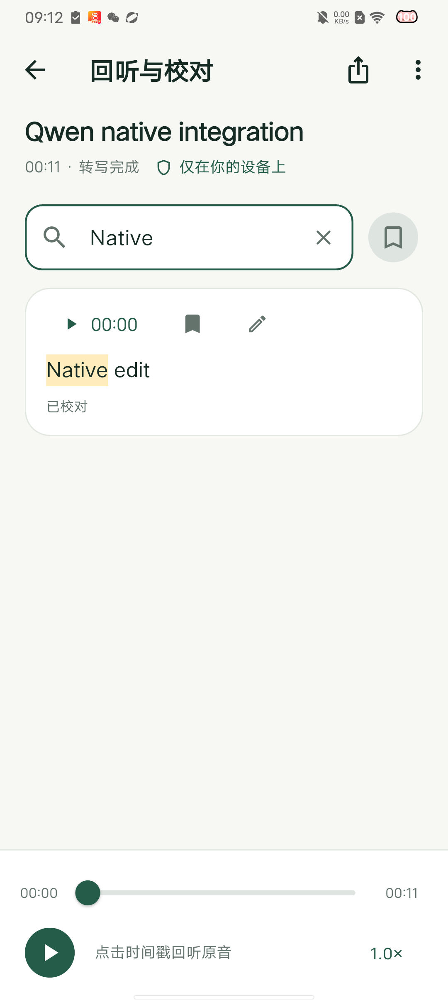

# 2026-10-13 真机界面复查

新版完整界面已在 vivo V2073A / Android 13 独立“聆写 QA”安装成功。手机实际 APK 与 d5784e3 构建包 SHA-256 一致，原生缓存的源码输入及库摘要已核对。检查只使用公开原生测试音频及其校对记录；未以预置虚构正文作为识别结果。最后停在完整资料库，原有模型保留。

以下截图均是本次真机复查实际采集、逐张检查后的原始截图，未作美化、合成或裁剪。英文测试名称、`Native edit` 和“任务中断”来自集成测试的校对/取消断言，不是正式产品样例或意外崩溃。

## 1. 资料库：正常

品牌、标题、搜索、记录状态和录音/导入入口完整可见。九条真实 QA 记录仍可访问，取消的记录明确提示音频已保留。当前截图只证明此机型的中文布局；实际录音质量、其他字号及完整资料库搜索流程仍需独立验收。

## 2. 离线模型：正常；文件选择器待真机验收

当前 Qwen 模型排在首位，边框、勾选和“当前使用”保持一致；Base 模型仍保留。没有执行删除或重复下载。六文件分次收集向导已有本机 UI 测试与两端实际模型摘要导入测试，但本轮未通过手机文件选择器重复导入整套模型，不能把这些验证合并称为已通过手机导入向导验收。

## 3. 设置与单份音频选项：正常

设置页说明默认偏好只作用于新录音/导入，并保留中英混合建议。打开公开英文夹具的取消重转写记录，单独指定 English、保存、强制退出自己的 QA 包后重启，再次打开仍为 English；随后核对全局默认仍是自动识别。没有启动新的转写或改写全局默认。提示词留空，词汇提示效果未在本轮测试。

自动选项名称在弹窗中被省略，下面的完整说明仍可见；辅助技术是否完整读出名称待 TalkBack 检查。

## 4. 回听与校对：正常；听感与辅助技术待验收

已保存的校对、标记、时间戳及回放控件正常显示。查找字面词 Native 后，高亮该词并保留完整的 Native edit；清除搜索后段落仍保留。手机输入法最初按拼音组合插入分隔符，确认文本后得到正确查找结果；组合中间状态的截图未用作成功证据。此次未播放音频或导出分享，不声称完成听感与所有导出格式的手机验收。

## 证据与范围

- 安装、截图摘要与操作范围：[真机界面报告](validation/android-physical-ui-d5784e3.json)。原始 XML 与最终资料库截图在本机 `build/ui-audit-20261013/`，无需重新安装测试入口。
- 8f654a7 的四项 CI 作业全部成功：[构建记录](https://github.com/YJxyzxyz/lingoscribe/actions/runs/38256287992)。该提交相对手机界面源码 d5784e3 仅增加文档和真机报告。CI 使用合成合并 a1d0369，其源码树与 8f654a7 一致。
- 两端 Whisper/Qwen 实际原生模拟器报告已下载核对归档摘要，保存在 `validation/*-native-8f654a7.json`；实际 iOS 未签名 App 独立复核 SDK 26.2 / Xcode 26.3、FFI、隐私声明、测试框架排除及插画摘要，通过 `validation/ios-bundle-8f654a7.json`。这些结果不代替物理 iPhone。
- UIAutomator 没有为两个空搜索框读出提示文字，TalkBack 的字段名称、焦点顺序及手势尚未验收；截图不能证明完整无障碍合规。
- 54 项应用测试、静态检查、两端构建与短样例真机管线通过，仍未达到商业发布验收。英文准确率、正式版手机速度/耗电、长音频、噪声、更多设备和签名/商店条件继续按 [商业门槛](COMMERCIAL_ACCEPTANCE.md) 执行。
